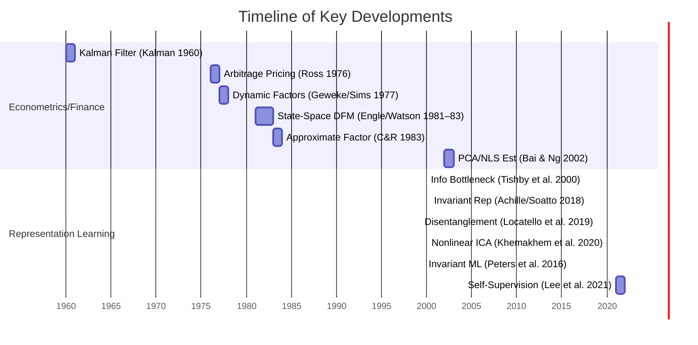

# Explain Paper Insights

**Date:** 2026-10-29
**Source:** chatgpt.com

---

### **You** · Thu 29 Oct, 7:14

What is this paper about?

[File: main(6).pdf]

---

### **ChatGPT** · Thu 29 Oct, 7:14

The paper, **“Pretrained Tabular Features and the Measurement of Financial Proximity”** (Marcus Gawronsky and Chun-Sung Huang, October 2026), investigates whether pretrained AI models can help measure how financially similar companies are—and whether that similarity can improve stock-market risk forecasts.

It sits at the intersection of **machine learning, financial econometrics, and portfolio risk modelling**.

## 1. The main research question

The paper asks:

**Can pretrained AI models identify companies that are exposed to similar economic risks better than traditional financial measures can?**

Two companies might operate in completely different industries but respond similarly to interest-rate changes, inflation, or economic downturns.

The authors call this **financial proximity**: how similarly companies respond to common economic shocks.

The important distinction is that companies can look similar financially without actually having similar risk exposures.

## 2. What the researchers did

The authors compare four pretrained tabular foundation models:

- **TabPFN 3.5**
- **Google TabFM 1.1**
- **Kumo-Tabular Large**
- **LimiX-2**

They compare these with traditional financial characteristics, principal component analysis (PCA), and a neural-network benchmark.

Using historical financial characteristics—including market capitalization relative to assets, market-to-book ratios, and dividend yields—they test three things:

<box gap={3}>
  <row align=start gap={3}>
    <box background="surface-secondary" radius="lg" padding={2}>
      <icon name="brain-circuit" size="lg"/>
    </box>
    <box flex="1" gap={1}>
      **Step 1: Can AI features predict financial risk exposures?**

      The researchers use regression to predict how firms respond to common return shocks.
    </box>
  </row>
  <row align=start gap={3}>
    <box background="surface-secondary" radius="lg" padding={2}>
      <icon name="network" size="lg"/>
    </box>
    <box flex="1" gap={1}>
      **Step 2: Do AI features identify financially similar companies?**

      They compare distances between raw AI representations with distances between estimated economic exposures.
    </box>
  </row>
  <row align=start gap={3}>
    <box background="surface-secondary" radius="lg" padding={2}>
      <icon name="chart-no-axes-combined" size="lg"/>
    </box>
    <box flex="1" gap={1}>
      **Step 3: Do those similarities improve risk forecasts?**

      They use the distances in covariance models that predict how stocks move together.
    </box>
  </row>
</box>

The empirical analysis uses approximately **440–500 US companies per evaluation year**, with covariance forecasts evaluated over 2020–2025.

## 3. The main findings

### Finding 1: Pretrained AI features predict historical exposures better

The pretrained models substantially outperform conventional financial histories when used with the same ridge-regression method.

<Chart content={{"chartType":"bar","meta":{"title":"Predicting historical financial exposures","description":"Mean out-of-fold R², 2016–2025. Higher is better. Source: Table 1, page 7."},"xKey":"model","series":[{"dataKey":"r2","label":"R²","valueFormat":"raw"}],"yAxisMin":0,"data":[{"model":"Direct histories","r2":0.072},{"model":"PCA","r2":0.044},{"model":"TabPFN","r2":0.262},{"model":"TabFM","r2":0.272},{"model":"Kumo","r2":0.274},{"model":"LimiX-2","r2":0.176}]}}/>

Kumo, TabFM and TabPFN achieve R² values around 0.26–0.27, compared with only 0.072 for direct financial histories.

This suggests that pretrained representations make financially relevant patterns easier for a relatively simple regression model to estimate.

### Finding 2: Better prediction does not automatically mean better risk modelling

Although the pretrained models predict exposures more accurately, distances between their original feature vectors produce weaker covariance forecasts than simple direct-history or PCA distances.

The crucial insight is:

**An AI representation can contain useful financial information without its geometric distances meaning anything economically useful.**

For instance, an AI model could place two companies far apart in its feature space even though they respond similarly to economic shocks.

### Finding 3: Translating AI features into economic exposures helps—but with an important qualification

When the researchers convert AI features into estimated exposure coordinates (a process they call *calibration*), all four pretrained models improve their covariance forecasts under separately fitted innovation variances.

However, when forecasts are standardized to have the same marginal variances, the calibration differences become negative in point estimates, with confidence intervals including zero.

This means **the paper does not establish that calibration improves the prediction of stock correlations independently of the variance treatment**.

### Finding 4: Historical stock returns remain a stronger benchmark

Models that construct financial proximity directly from historical stock-return exposures perform better than the pretrained-feature approaches in the principal covariance comparison.

This is an important limitation: the AI approach is useful for estimating exposures from accounting information, but it does not outperform the strongest return-based risk models in this study.

## 4. What is the paper's contribution?

Its contribution is both conceptual and empirical.

The authors argue that evaluating financial AI models requires distinguishing three separate questions:

| Question | What the paper establishes |
|---|---|
| Does the representation contain accessible information about risk? | Pretrained features predict the historical exposure proxy better with ridge regression. |
| Does distance in the representation measure economic similarity? | Not necessarily; exposure calibration gives distance a clearer interpretation. |
| Does the resulting measure improve covariance forecasts? | Sometimes, depending on the covariance specification and variance treatment. |

The paper also develops mathematical results explaining why successful prediction does not guarantee meaningful feature distances and how exposure-estimation errors can affect covariance forecasts.

## 5. Important limitations

The authors explicitly describe their empirical study as retrospective rather than a clean historical backtest.

In particular, the sample contains currently surviving firms, some pretrained-model checkpoints were released after the years being evaluated, and model configurations were examined using evaluation-period results.

The estimated exposure targets are also historical statistical proxies, not independently observed economic exposures.

Consequently, the results should not be interpreted as proof that these AI models will improve future investment performance.

## 6. The bottom line

The central message is:

**Pretrained AI models can make it easier to extract useful financial-risk information from company fundamentals, but predicting risk exposures, measuring similarity, and forecasting covariance are three different problems.**

The paper finds evidence for the first benefit, conditional improvements for the third, and warns against assuming that distances in AI-generated feature spaces are automatically economically meaningful.

In simpler terms, **AI can help us understand which companies have similar risks—but we must translate its representations into financially meaningful quantities and test whether those quantities actually improve risk forecasts.**

For understanding the paper in more depth, the most important sections are **Section 2 (the theoretical framework), Section 3 (the empirical design), and Section 4 (the results)**. The main conclusions are summarized in Tables 1–3 on pages 7–8.

---

### **You** · Thu 29 Oct, 7:41

Can you explain to me in a little bit more detail what exactly the theoretical proofs and insights this paper tries to present and connect

---

### **ChatGPT** · Thu 29 Oct, 7:42

<small><strong>Reasoning / progress:</strong><br>
Good question — I&#39;ll pull out the core theoretical links for you.<br>
<br>
The theory is basically a chain of distinctions, not a proof that AI magically improves forecasts. It starts by pinning down what “financial proximity” should mean in a math sense. It defines distance by how similarly firms respond to common shocks. Then, there&#39;s a key proposition: a representation that&#39;s great for one prediction task doesn&#39;t have to preserve the true risk information you care about. You can warp the feature space and still get good predictions, so raw feature distances might be meaningless. That&#39;s why they “cal calibrate” the AI features, namely, translate them into estimated exposure coordinates, so distances actually reflect response to shocks. Next, they show why a frozen encoder can still help a simple regression. It might make the right relationships easier to estimate without adding new information. Then they show how exposure estimation errors flow into neighbor networks and covariance forecasts, assuming the rest of the model is fixed. But they also show that better exposure estimates don&#39;t necessarily mean better forecasts, because noise and variance fitting matter. The punchline is that prediction power, meaningful similarity, and forecasting performance are three separate problems. That&#39;s why the paper tests them separately. And that&#39;s also why they caution against treating AI feature distances as economic truth.</small>

The key to understanding the theoretical contribution is that the paper tries to connect **three different mathematical problems** that are often treated as though they were the same:

<box border radius="xl" padding={3} gap={2}>
  <box background="surface-secondary" radius="md" padding={3} align="center" gap={1}>
    **1. Information and prediction**

    <text size="sm" textAlign="center">Does an AI representation contain information about a firm's economic exposures?</text>
  </box>
  <row justify="center">
    <icon name="arrow-down" color="secondary" size="lg"/>
  </row>
  <box background="surface-secondary" radius="md" padding={3} align="center" gap={1}>
    **2. Economic measurement**

    <text size="sm" textAlign="center">Can we estimate those exposures and construct meaningful distances between firms?</text>
  </box>
  <row justify="center">
    <icon name="arrow-down" color="secondary" size="lg"/>
  </row>
  <box background="surface-secondary" radius="md" padding={3} align="center" gap={1}>
    **3. Covariance forecasting**

    <text size="sm" textAlign="center">Do those distances help forecast how stock returns move together?</text>
  </box>
</box>

The proofs in Section 2 and Appendix A explain why success at one stage does not guarantee success at the next.

## 1. Establishing what financial proximity actually means

The paper begins with a model of residual stock returns:

\[
u_i=b_i^\top q+e_i
\]

Here, \(b_i\) represents a company's exposures to common shocks, \(q\) represents those shocks, and \(e_i\) represents firm-specific noise.

The authors define the economic distance between two companies as:

\[
d_E(i,j)=\sqrt{(b_i-b_j)^\top\Omega(b_i-b_j)}
\]

where \(\Omega\) is the covariance matrix of common shocks.

This has an important interpretation: two firms are close if their *differences in responses to common shocks* have low variance.

For example, suppose two companies operate in different industries but have similar exposure to interest-rate shocks. Their financial statements might look different, yet they could be close in economic risk space.

The authors also prove a covariance identity:

\[
b_i^\top\Omega b_j
=\frac12\left(\|a_i\|^2+\|a_j\|^2-\|a_i-a_j\|^2\right)
\]

where \(a_i=\Omega^{1/2}b_i\).

This connects economic distance to shared covariance. But notice that covariance depends on both **distance and the magnitudes of the exposures**. Distance alone is insufficient.

That is the theoretical foundation for the paper's definition of financial proximity. <FileCite ref="turn0file0" line_range_start={541} line_range_end={553}/>

## 2. Proposition 1: Predicting one task does not guarantee information about another

This is arguably the paper's most fundamental theoretical insight.

Suppose a pretrained model takes financial histories \(H\) and learns a representation:

\[
z=E(H)
\]

It was trained for some auxiliary prediction task, such as predicting a valuation-related outcome.

Let \(F(H)\) represent the information needed for that task, and let \(s(H)\) represent the economic exposure target we actually care about.

Proposition 1 states that **every representation sufficient for the auxiliary task is also sufficient for the economic target if and only if**:

\[
F(H)=F(H')\implies s(H)=s(H')
\]

In plain terms, whenever two financial histories are indistinguishable for the original prediction task, they must also have the same economic target.

Why?

The proof has two directions. For necessity, imagine an encoder that retains only \(F(H)\). If two firms have the same task information but different risk exposures, this encoder cannot distinguish their exposures. For sufficiency, if equal task information always implies equal economic targets, then the economic target can be recovered as a function of the task information.

**The insight:** a foundation model can be excellent at predicting company valuations without being guaranteed to preserve the distinctions required for covariance forecasting.

A particular encoder may retain extra information, but success on its original task does not establish that fact. <FileCite ref="turn0file0" line_range_start={554} line_range_end={581}/>

## 3. Why accurate AI predictions do not identify meaningful embedding distances

The paper then makes a second, distinct argument.

Suppose a neural representation \(z\) gives excellent predictions through a prediction function \(h(z)\).

Apply any invertible transformation \(T\) to its coordinates, and modify the prediction function accordingly:

\[
\widetilde z=Tz,\qquad
\widetilde h=h\circ T^{-1}
\]

Then:

\[
\widetilde h(\widetilde z)=h(z)
\]

The predictions are identical.

But the distances between the transformed feature vectors need not be identical.

For example, stretching one coordinate can make two normalized vectors arbitrarily close together, even though the model's predictions have not changed.

This means that **prediction accuracy cannot uniquely determine the geometry of the feature space**.

That is a serious issue if we intend to use Euclidean or cosine distance between embeddings as a measure of economic similarity.

The authors therefore propose estimating an explicit mapping from embeddings to exposure coordinates. This is what they call *calibration*.

Rather than asking whether two firms have similar AI features, calibration asks whether they have similar **estimated responses to economic shocks**.

## 4. Proposition 2: Why pretrained features can improve estimation without adding information

This is the statistical learning argument.

The authors decompose exposure prediction error:

\[
\mathbb E\|s-g(z)\|^2
=
\underbrace{\mathbb E\|s-m_E(z)\|^2}_{\text{Information error}}
+
\underbrace{\mathbb E\|m_E(z)-g(z)\|^2}_{\text{Readout error}}
\]

Here \(m_E(z)=\mathbb E[s\mid z]\) is the best possible squared-error prediction using the representation.

The first term is uncertainty that cannot be resolved from the features. The second is how far the fitted regression is from the best possible prediction using those features.

The crucial observation is that a frozen encoder is a transformation of the financial histories. Conditional on fixed weights and context, it cannot contain more information about the target than the full input history.

Nevertheless, the encoder may transform complicated nonlinear relationships into coordinates that a simple ridge regression can use effectively.

Proposition 2 formalizes this with an estimation bound:

\[
R_Q(\widehat g;E)
\leq
I_Q(E)+A_Q(E,\mathcal G)
+2\Delta_{n,Q}+\varepsilon_{\mathrm{fit}}
\]

The four terms represent information error, approximation error, empirical estimation discrepancy, and optimization error.

**The conceptual connection:** an encoder may discard some information but reduce approximation or estimation difficulty enough to improve the fitted prediction.

This is a conditional bound, not a theorem that pretraining must outperform raw financial histories. It also does not provide a pretraining-specific convergence rate. <FileCite ref="turn0file0" line_range_start={599} line_range_end={641}/>

## 5. Proposition 3: Connecting exposure estimation to covariance forecasting

Now suppose we have estimated each firm's exposure vector.

How does prediction error affect the financial proximity measure?

Using the reverse triangle inequality, the paper establishes:

\[
|\widehat d_{ij}-d_{ij}|
\leq\delta_i+\delta_j
\]

where \(\delta_i\) and \(\delta_j\) are the errors in the two estimated exposure vectors.

So accurate exposure estimates, in a shared coordinate system, control errors in the resulting distances.

The authors then convert distances into neighbor weights:

\[
W_{ij}=
\frac{\exp(-d_{ij}/h)}
{\sum_{k\ne i}\exp(-d_{ik}/h)}
\]

Proposition 3 proves that if every pairwise distance changes by at most \(\epsilon\), then:

\[
\|W-W^\star\|_\infty
\leq \min\{2,e^{2\epsilon/h}-1\}
\]

This tells us that small distance errors lead to controlled changes in the network, conditional on the bandwidth.

They then establish a corresponding bound on changes in the spatial covariance matrix, **holding the spatial coefficient and innovation covariance fixed**.

The important qualification is that these are stability results, not forecast-improvement guarantees. A stable estimate of the wrong relationship can still forecast poorly. <FileCite ref="turn0file0" line_range_start={653} line_range_end={736}/>

## 6. The final connection: Better neighbors are not automatically better covariance forecasts

The spatial model is:

\[
u=\lambda Wu+\varepsilon
\]

The paper derives the expected squared filtered residual:

\[
\mathbb E[(Qu)_i^2]
=
\left\|a_i-\lambda\sum_jW_{ij}a_j\right\|^2
+\sigma_i^2
+\lambda^2\sum_jW_{ij}^2\sigma_j^2
\]

This equation reveals a trade-off.

Selecting neighbors with similar exposures can reduce the first term. However, neighbors also introduce their own idiosyncratic noise, represented in the final term.

Consequently, even more accurate economic proximity does not guarantee a better covariance forecast.

The covariance forecast must ultimately be assessed using a forecasting loss. The authors use Gaussian log scores and show that their expected loss evaluates the covariance matrix through its log determinant and inverse-weighted second moment.

This is the theoretical reason that the paper separately tests exposure prediction, distances, and covariance scores.

## 7. How the empirical results connect back to the proofs

Consider the findings for the pretrained models.

| Theoretical question | Empirical finding |
|---|---|
| Can pretrained features make the exposure target easier to estimate? | Yes, under the common ridge readout. |
| Are native embedding distances automatically useful economic distances? | No; their covariance forecasts underperform simple native-distance benchmarks. |
| Does exposure calibration help forecasting? | Yes under separately fitted innovation variances, but not established under common marginal variances. |
| Does the paper prove pretrained features are superior to return-based risk information? | No; historical return-based benchmarks remain stronger in the principal fitted-variance comparison. |

The distinction is particularly important for the third row. Under fitted innovation variances, calibration improves all four pretrained covariance procedures. Once full forecasts are standardized to common marginal variances, all four calibrated-minus-native point differences are negative, with confidence intervals spanning zero.

That result does not contradict the theoretical bounds. The bounds explain how estimation errors can propagate through a *fixed* covariance construction; the empirical experiment compares procedures that fit their parameters and variance scales. <FileCite ref="turn0file0" line_range_start={340} line_range_end={349}/>

## My interpretation of the theoretical contribution

The paper's most important contribution is not a new theorem proving that foundation models are inherently better financial risk models.

It is the separation of three concepts that are easy to conflate:

**Predictive sufficiency** tells us what information a representation must retain to solve a task.

**Statistical estimation** tells us how effectively a restricted model can recover an economic target from that representation and finite financial data.

**Economic geometry and forecasting** tell us whether the recovered relationships generate useful covariance predictions.

The proofs connect these concepts mathematically while showing why none of the implications is automatic.

In particular, Proposition 1 addresses whether the required information is retained, Proposition 2 addresses the difficulty of estimating it, and Proposition 3 addresses how estimation error can affect the covariance construction.

That is the central intellectual structure of the paper. The empirical results then demonstrate why each link needs separate validation, rather than treating successful machine-learning prediction as evidence of economically meaningful similarity or superior portfolio risk forecasts.

---

### **You** · Thu 29 Oct, 7:44

What statistical learning theory do they rely on

---

### **ChatGPT** · Thu 29 Oct, 7:44

<small><strong>Reasoning / progress:</strong><br>
One sec, let me trace that.<br>
<br>
It&#39;s mostly classical statistical learning theory, representation learning plus generalization bounds around empirical risk minimization. They lean on conditional expectation as the optimal predictor under squared loss, then decompose excess risk into approximation plus estimation error, very standard stuff. They also cite transfer learning and multitask representation theory to motivate why pretraining might reduce sample complexity for a new task, though they don&#39;t prove a new rate themselves. And there&#39;s a stability angle. Small errors in estimated exposures lead to bounded changes in neighbor weights and covariance under fixed assumptions, using fairly standard Lipschitz-style arguments. Nothing exotic like a brand new foundation model theory. Mostly careful use of existing tools to separate information from accessibility. For the math, their Appendix A.1 and A.2 are the most relevant.</small>

The paper relies primarily on **classical statistical learning theory**, especially **representation learning, conditional expectation, empirical risk minimization, and generalization-error decomposition**. It combines these with ideas from information theory and mathematical stability analysis.

There are five important theoretical foundations.

**First, statistical sufficiency and the information bottleneck idea.** The authors ask whether a representation learned for one task retains enough information for a different task. Their first proposition establishes a necessary and sufficient condition for this: if two inputs are indistinguishable for the original prediction task, they must also be indistinguishable for the financial exposure target. This is closely related to sufficient statistics, although the paper does not directly prove an information-bottleneck theorem.

**Second, the conditional expectation projection theorem.** This is particularly central. Under squared-error loss, the optimal predictor of an exposure \(s\) from a representation \(z\) is:

\[
m(z)=\mathbb E[s\mid z].
\]

The authors use the orthogonality property of conditional expectations to decompose prediction risk into irreducible information error and the error of the fitted predictor. They also use the tower property of conditional expectation to show that a deterministic transformation of financial histories cannot improve their information-theoretic optimal prediction risk. It can, however, make the target easier for a restricted regression to estimate.

**Third, empirical risk minimization and generalization bounds.** Proposition 2 is essentially an oracle inequality. It bounds the population risk of a fitted regression by information error, approximation error, a uniform empirical-to-population risk discrepancy, and optimization error.

The important formula is:

\[
R(\widehat g)\leq I+A+2\Delta+\varepsilon.
\]

This is standard learning-theoretic machinery. The intuition is that a pretrained representation may reduce approximation and estimation difficulty even without adding information. The paper does not establish a specific sample-complexity rate for the pretrained models, because it assumes a uniform risk discrepancy rather than deriving one from Rademacher complexity, VC dimension, or covering numbers. <FileCite ref="turn1file0" line_range_start={599} line_range_end={641}/>

**Fourth, transfer learning and multitask representation learning.** The paper explicitly draws motivation from Baxter's inductive-bias learning, Maurer, Pontil, and Romera-Paredes' multitask representation-learning theory, and Lee and colleagues' theoretical work on self-supervised transfer.

These literatures investigate when knowledge acquired from auxiliary tasks reduces the amount of labeled data needed for a target task. That is precisely the intuition behind freezing a pretrained tabular model and fitting a small financial readout. However, the paper cites these theories as motivation; it does not directly derive their transfer-learning guarantees for the financial setting.

**Fifth, Lipschitz stability and perturbation bounds.** Once exposures are estimated, the authors use the reverse triangle inequality to control errors in distances. They then derive bounds showing how distance perturbations affect exponential-kernel neighbor weights and, subsequently, a spatial covariance matrix. These results depend on fixed bandwidth, spatial coefficient, innovation covariance, and suitable inverse-norm conditions.

There is also an important connection to **proper scoring rules**. The paper uses the fact that expected Gaussian log loss is minimized by the correct second-moment matrix, given the fixed mean used for scoring. This supports evaluating covariance forecasts even without assuming that returns are normally distributed.

The main distinction I would emphasize is that **the paper uses established learning-theoretic tools to construct a measurement framework; it does not introduce an entirely new generalization theory for foundation models**.

Its strongest statistical-learning argument is about the difference between *information* and *accessibility*. A pretrained model cannot create new information about a target from a fixed input, but it can reorganize that information so that a simple estimator learns more effectively from a limited financial sample.

That is why Proposition 2 is probably the most important result to understand if you're approaching the paper from machine learning theory, while Proposition 1 is most important if you're interested in representation sufficiency and transfer learning.

For the mathematical details, the most relevant sections are Appendix A.1 and A.2, on pages 11–12.

---

### **You** · Thu 29 Oct, 7:45

What is the, um, what is the multitask and self-supervised learning theory which they build on

---

### **ChatGPT** · Thu 29 Oct, 7:45

<small><strong>Reasoning / progress:</strong><br>
Sure, I&#39;ll trace the exact theories they cite.<br>
<br>
They mainly point to Baxter ’00, Maurer Pontil Romera-Paredes ’16, and Lee et al. ’21. The unifying idea is that learning across many related tasks can reduce how much data you need for a new one. In Baxter and Maurer et al., you learn a shared representation that makes each task simpler, and the generalization bounds improve as the number of tasks grows. In Lee et al. ’21, it&#39;s self-supervised transfer: an auxiliary task helps only if it preserves information relevant to the downstream target. The paper uses that intuition to say: pretraining may make exposure estimation easier, but that alone doesn&#39;t guarantee useful economic distances.</small>

The paper draws on three particular theoretical works: **Baxter (2000), Maurer, Pontil and Romera-Paredes (2016), and Lee, Lei, Saunshi and Zhuo (2021)**. They investigate a common question: *why can learning from other tasks make it easier to learn a new task with relatively little labeled data?*

The distinction is that multitask learning learns across several related tasks, whereas self-supervised learning constructs an auxiliary prediction problem from data that may not have target-task labels.

### 1. Baxter (2000): Learning an inductive bias

Baxter's idea is that when you learn many related tasks, you can discover a common hypothesis space that is useful across them.

Imagine predicting profitability, leverage, valuation, and default risk. Instead of separately learning every relationship from raw financial data, you learn a shared representation that makes these prediction problems simpler.

Mathematically, you might learn an encoder \(\phi\) and task-specific predictors \(g_t\):

\[
f_t(x)=g_t(\phi(x)).
\]

The theoretical benefit comes from distributing the cost of learning a suitable representation across many tasks. As the number of related tasks increases, the representation can be learned more reliably, subject to assumptions about the shared task environment.

### 2. Maurer et al. (2016): Generalization bounds for shared representations

This work makes the statistical argument more precise.

It examines a common representation learned across multiple tasks, followed by a relatively simple predictor for each task.

The theory separates the difficulty of learning the shared representation from the difficulty of learning an individual task's prediction function.

Under suitable assumptions, a schematic form of the generalization bound is:

\[
\text{Excess risk}
\lesssim
\underbrace{\frac{C_{\mathrm{representation}}}{\sqrt{nT}}}_{\text{shared learning}}
+
\underbrace{\frac{C_{\mathrm{task}}}{\sqrt n}}_{\text{task-specific learning}}.
\]

Here, \(T\) is the number of training tasks and \(n\) is the number of observations per task. This is an illustration of the scaling intuition, not the paper's exact theorem.

The important insight is that increasing the number of related tasks can reduce the per-task cost of estimating the shared representation. The target task then only needs to learn a relatively simple prediction rule.

**This connects directly to the financial paper:** a pretrained tabular model may already encode complicated interactions between financial variables, so the authors only need a ridge regression to estimate exposure coordinates.

### 3. Lee et al. (2021): Provable self-supervised transfer learning

This theory addresses a slightly different problem.

Suppose you have considerable data but very few labels for the ultimate prediction target.

You first train a representation using an auxiliary task. For instance, you might predict one part of an observation from another part, then use the resulting features for a downstream task.

But why should solving the auxiliary task help?

The crucial condition is that **the auxiliary prediction problem must preserve information relevant to the downstream target**.

A useful way to express the underlying idea is:

\[
\text{Downstream error}
\leq
\text{Transfer-related approximation error}
+
\text{Estimation error}.
\]

Self-supervision can improve the downstream problem when the auxiliary task reveals useful structure and the downstream predictor can exploit it. The exact guarantees depend on structural assumptions linking the pretext and target tasks.

This is particularly relevant to the paper's Proposition 1. The authors ask whether information sufficient for predicting a valuation outcome is also sufficient for estimating financial risk exposures.

Their answer is that this is **not guaranteed**. A representation could preserve expected valuation while discarding information about sensitivity to economic shocks.

### How the three theories fit together

Baxter supplies the idea of learning a useful inductive bias across tasks. Maurer and colleagues formalize the statistical benefits of sharing a representation across tasks. Lee and colleagues investigate when an auxiliary self-supervised prediction task can help a downstream task.

The financial paper takes the intuition from these theories but adds a qualification: even if pretraining improves downstream prediction, it doesn't follow that distances between the learned feature vectors are economically meaningful.

That is why the authors distinguish learning a representation, estimating financial exposures from it, and using those exposures in covariance forecasts.

**One important limitation:** the financial paper cites these three works as theoretical motivation. It does not establish that the tabular foundation models satisfy the assumptions of their transfer-learning theorems, nor does it derive an explicit sample-complexity improvement from their results.

So the intellectual connection is clear, but it is not a direct application of an existing transfer-learning theorem. The paper's own mathematical contribution is to formalize the conditions for transferring task information to economic measurement and to study what happens when the resulting estimates are used in a risk model.

---

### **You** · Thu 29 Oct, 7:46

So, um, how exactly is this multitask learning uh, used within um, their proofs they present

---

### **ChatGPT** · Thu 29 Oct, 7:46

<small><strong>Reasoning / progress:</strong><br>
Right, let me line that up with their propositions.<br>
<br>
They don&#39;t actually assume multitask learning in the proofs. It&#39;s more like motivation in the background. In the proofs they ask: Given a frozen pretrained encoder, what can we say about financial prediction error from a simple regressor on top of it? So Proposition 2 is a standard risk bound conditioned on whatever representation you feed it. No term for number of pretraining tasks or task similarity appears. Proposition 1 checks task alignment logically; it&#39;s not a multitask bound. And Proposition 3 just propagates estimation error. So multitask learning explains why pretraining might help, but the proofs avoid assuming it works. They just analyze consequences given a representation. If you&#39;re judging novelty, that distinction matters a lot.</small>

**Multitask learning is not actually used as a mathematical assumption in the paper's proofs.** It provides the motivation for why pretrained representations might help, but the authors deliberately avoid relying on a multitask generalization theorem.

That's an important distinction.

In traditional multitask learning theory, such as Maurer et al. (2016), you assume several related tasks share a useful representation. You then prove that learning this representation across tasks can reduce the estimation burden for each individual task.

In this paper, however, the authors start *after* that learning has happened. They take an already-pretrained encoder, freeze its weights, and ask what can be established about its financial usefulness.

The connection becomes clearest in Proposition 2.

The authors write the financial prediction risk as an information component, an approximation component, and an estimation component. Their principal bound is:

\[
R_Q(\widehat g;E)
\leq I_Q(E)+A_Q(E,\mathcal G)
+2\Delta_{n,Q}+\varepsilon_{\mathrm{fit}}.
\]

The connection to multitask learning is through the **approximation and estimation terms**.

Imagine the true financial exposure depends on a complicated nonlinear interaction between a firm's market-to-book ratio and its historical dividend yield. A regression on the original variables might struggle to estimate that interaction using only a few hundred companies.

But suppose the pretrained encoder has already learned a feature capturing something close to that interaction. A simple ridge regression can now recover its relationship with the exposure target.

That is exactly the intuition from multitask representation learning: learn complicated shared structure using other tasks, then estimate a simpler task-specific predictor.

**But here's what the proof does not do.** It never introduces the number of pretraining tasks, the distribution of those tasks, or a measure of task relatedness. It also doesn't derive a bound showing that increasing the number of pretraining tasks reduces financial prediction error.

Instead, it conditions on the pretrained encoder being fixed. The proof is essentially a standard empirical-risk-minimization argument applied to whichever representation you supply, whether pretrained, randomly initialized, or hand-designed. <FileCite ref="turn3file0" line_range_start={613} line_range_end={641}/>

The same distinction applies to Proposition 1. It asks whether successfully solving an auxiliary task guarantees that the learned representation contains information about the financial exposure target. The condition is that any two financial histories indistinguishable for the auxiliary task must also have identical exposure targets.

This is a **task-alignment condition**, not a multitask-learning generalization bound.

And Proposition 3 is even further removed from multitask learning. It simply shows how errors in estimated distances propagate into network weights and covariance matrices, holding other parameters fixed.

So the exact relationship is this: **multitask learning motivates why the encoder might produce useful features; Proposition 1 tests the logical requirement for transferring information; Proposition 2 formalizes the prediction-risk consequences of using a fixed representation; and Proposition 3 connects estimation errors to financial risk modelling.**

The authors' contribution is therefore not proving that multitask pretraining works. It is building a framework for evaluating the financial consequences of representations obtained through pretraining, without assuming that pretraining necessarily makes them economically useful.

If you're assessing the theoretical novelty of the paper, this distinction matters substantially: Proposition 2 is a conventional oracle inequality, and the paper's originality lies more in how it connects representation sufficiency, economic exposure estimation, and covariance stability than in extending multitask learning theory itself.

---

### **You** · Thu 29 Oct, 7:47

So do we just have like a number of disconnected proofs then

---

### **ChatGPT** · Thu 29 Oct, 7:47

<small><strong>Reasoning / progress:</strong><br>
Good check. Let me tie those together briefly. Not entirely, but they also don&#39;t collapse into one unified theorem. It&#39;s a chain: Prop 1 says when task information might transfer, Prop 2 bounds estimation error from a frozen representation, and Prop 3 shows how estimation error perturbs the covariance construction. But they never combine them into a single end-to-end generalization guarantee. So it&#39;s coherent as a framework, but modest as a unified theorem contribution. Stronger would be one theorem linking pretraining quality, sample size, exposure error, and covariance loss. They stop short of that.</small>

**Not entirely. The proofs are conceptually connected, but they do not form a single unified theorem.** That's an important distinction when evaluating the paper's theoretical contribution.

The authors are constructing a chain from representation learning to financial risk measurement.

The first proposition asks whether a pretrained representation preserves the information needed to recover economic exposures. The second asks how accurately those exposures can be estimated from the representation using a finite financial sample. The third asks how errors in the estimated distances affect the resulting covariance model.

So there is a logical sequence:

\[
\text{Representation}
\rightarrow
\text{Exposure estimation}
\rightarrow
\text{Financial distances}
\rightarrow
\text{Covariance forecast}
\]

The mathematical connection is strongest between Propositions 2 and 3. Proposition 2 bounds the prediction risk of the exposure estimator. The reverse triangle inequality then relates exposure-estimation errors to distance errors. Proposition 3 shows how uniformly bounded distance errors affect network weights and covariance matrices under fixed model parameters.

But there's a gap: **the paper doesn't combine these results into one end-to-end generalization bound for covariance forecasting.** It doesn't prove, for example, that more pretraining tasks lead to a particular reduction in exposure error, which then guarantees a corresponding improvement in out-of-sample covariance loss.

Proposition 1 is even more separate mathematically. It's a characterization of when an auxiliary task preserves sufficient information for another target. It doesn't establish that the particular pretrained models satisfy that condition.

So I would distinguish two interpretations.

As a *measurement framework*, the proofs are coherent. They identify the separate conditions necessary for pretrained representations to become economically meaningful and explain why better prediction need not imply better forecasting.

As a *unified theoretical contribution*, they're more limited. Much of the mathematics consists of established arguments: sufficiency through function factorization, conditional-expectation projection, an empirical-risk oracle inequality, and perturbation bounds.

**My assessment is that the paper has a coherent theoretical narrative but a relatively modest integrated theorem-level contribution.** Its originality lies mainly in connecting these tools to the specific financial measurement problem and then showing empirically where the proposed connections succeed or fail.

A stronger unified theoretical result would explicitly connect pretraining quality, downstream sample size, exposure estimation error, and covariance forecasting loss in a single theorem. The paper stops short of that, and its own qualifications about fixed covariance parameters and the absence of pretraining-specific rates make that limitation clear.

---

### **You** · Thu 29 Oct, 7:48

And how exactly is this tied um, to the notion of economic state, and how is the notion of economic state itself formalized

---

### **ChatGPT** · Thu 29 Oct, 7:48

<small><strong>Reasoning / progress:</strong><br>
Good question. I&#39;ll pin that down precisely.<br>
<br>
In the paper it&#39;s theoretical , not a fully specified structural model. They write that a firm&#39;s economic state S is some underlying thing, and what they formalize is the consequence of that state: exposures b of S enter returns as sensitivity to common shocks. Two firms are “close” if their exposure vectors are close. What&#39;s not fully formalized is how S itself is generated or identified from data; the paper treats it as latent and focuses on whether observed histories contain enough information to estimate exposures reliably. That&#39;s why they emphasize irreducible information error and why they warn that even perfect embedding of histories may not recover true economic state. My read is that a big theoretical gap is exactly there: no explicit model of the state or proof that the proxy exposures match it—so it&#39;s more a measurement framework than a full structural theory.</small>

The important distinction is that **economic state is introduced as a latent theoretical object, but the paper does not fully specify a structural model of that state**. Instead, it formalizes the relationship between economic state and financial risk exposures.

In Section 2.1, the authors write:

\[
b_i=b(S_i)\in\mathbb R^k
\]

Here, \(S_i\) is firm \(i\)'s underlying economic state, and \(b(\cdot)\) maps that state into a vector of exposures to common shocks.

For example, a firm's economic state might include its leverage, business model, financing constraints, and sensitivity to economic conditions. These are illustrative possibilities rather than a state vector explicitly defined by the authors.

They then specify residual returns as:

\[
u_i=b(S_i)^\top q+e_i
\]

where \(q\) is a vector of common shocks and \(e_i\) is firm-specific noise.

So the **observable financial implication of economic state** is the way a company responds to common shocks.

Two companies can have different underlying states but identical exposure vectors. In that case, the paper treats them as economically equivalent for the particular notion of risk proximity being studied.

This leads to the distance:

\[
d_E(i,j)=
\sqrt{(b(S_i)-b(S_j))^\top
\Omega(b(S_i)-b(S_j))}
\]

where \(\Omega\) is the covariance matrix of common shocks. <FileCite ref="turn5file0" line_range_start={85} line_range_end={113}/>

Now, how does this connect to the proofs?

The key distinction is between the latent state \(S_i\), the observed financial history \(H_i\), and the model's representation \(z_i=E(H_i)\).

The paper does **not** assume that \(H_i\) perfectly reveals \(S_i\). Consequently, even a perfect representation of the observed history may be unable to recover the true economic exposure.

Proposition 1 addresses a narrower question: whether the information retained for an auxiliary prediction task is sufficient to recover a declared target determined by the history. It does not prove recovery of the latent economic state.

Proposition 2 then measures how well the exposure target can be predicted from the representation. Its irreducible information-error term is particularly important because it allows uncertainty to remain even after observing the representation.

Proposition 3 takes estimated exposure coordinates and analyzes how errors in those coordinates affect financial distances and covariance construction.

So the theoretical chain is:

**Latent economic state determines exposures; observed financial histories provide imperfect information about those exposures; pretrained representations transform the histories; financial calibration estimates exposures from those representations; and the resulting distances enter covariance forecasts.**

But here is the substantive limitation.

The authors do not define a state space with specified economic variables, a probability law for the state, a dynamic transition equation, or an identification theorem showing how the state can be recovered from financial observations.

Nor do they prove that their estimated historical factor loadings equal the structural exposures \(b(S_i)\). In fact, they explicitly distinguish predicting historical exposure proxies from recovering latent economic exposures.

Empirically, they construct five reference factors from historical return residuals and estimate company loadings on those factors. Those loadings become the prediction targets. <FileCite ref="turn5file0" line_range_start={208} line_range_end={219}/>

**My assessment is that economic state serves primarily as the conceptual foundation for defining a meaningful risk distance, rather than as a fully modeled or identified latent variable.**

That leaves a potentially significant theoretical gap: the paper formalizes how errors propagate *once an exposure target is specified*, but does not establish when that exposure target is an accurate representation of the underlying economic state.

This is also where a more unified theory could make a genuine contribution: by specifying a latent-state model, describing how financial histories reveal that state, and deriving conditions under which pretrained representations recover the economically relevant part of it.

---

### **You** · Thu 29 Oct, 7:49

It seems like the authors um, have this very loose connection between statistical learning theory and what they're trying to uh, prove, um, and show, which is um, that multitask and self-supervised pre-training satisfies some um, conditions um for econometric applications, which would be this notion of economic state. And so it feels like to a large degree in their work, that they're almost moving blindly because of this lack of some rigorous, defined objective, which is economic state. What its properties are, what its requirements are, um, etc

---

### **ChatGPT** · Thu 29 Oct, 7:50

<small><strong>Reasoning / progress:</strong><br>
Yeah, let me take that apart carefully before I answer. I think that&#39;s a sharp critique, but it&#39;s important to separate two things: an underspecified economic state versus an undefined objective. The objective isn&#39;t totally undefined; they clearly optimize for predicting a particular exposure proxy and improve covariance forecasts. What&#39;s weak is the bridge between that proxy and well-defined economic state. They posit a state but never specify how it&#39;s encoded in histories or identified, so the learning theory results operate on a target whose economic validity is assumed rather than derived. That&#39;s not blindness—they&#39;re explicit about predictive targets and even show cases where it fails—but it is a structural gap if the ambition is economic state recovery, not just better prediction on a chosen proxy. If they wanted stronger foundations, they&#39;d need to define what counts as recovering state and prove when pretraining retains that, not only when it helps fit a historical exposure vector. That would make &quot;economic state&quot; more than a motivating label.</small>

I think your criticism identifies a genuine limitation, but I would distinguish **an insufficiently formalized economic state from an undefined research objective**. The former is a weakness of the paper's theoretical foundations; the latter is not entirely accurate, because the authors do define a measurable target and a forecasting criterion.

The critical issue is that these are not necessarily the same as recovering an economically meaningful state.

The authors introduce a latent state \(S_i\), map it to economic exposures \(b(S_i)\), and define similarity through responses to common shocks. That gives the concept an operational meaning. However, they do not specify the state space, its underlying economic variables, its dynamics, or the conditions under which observed financial histories identify it.

Their empirical substitute is a vector of historical factor loadings, estimated from residual stock returns. **That proxy is mathematically defined, but its relationship to the latent economic state is not established.** The paper explicitly acknowledges the distinction between predicting the historical proxy and recovering latent exposures. <FileCite ref="turn6file0" line_range_start={85} line_range_end={113}/>

This matters for the statistical learning theory.

Proposition 1 establishes when an auxiliary prediction task retains enough information for a declared target. But the target is defined as a function of observed history, not necessarily the latent economic state. The proposition therefore cannot establish that multitask or self-supervised pretraining preserves economically sufficient information about \(S_i\).

Proposition 2 bounds the error of estimating that declared target from frozen features. Yet even a very small estimation error would not establish structural validity if the historical factor-loading proxy inadequately captures the economic exposure of interest.

Proposition 3 then controls how errors in distances affect covariance construction. Again, it works conditional on the chosen exposure coordinates and fixed model parameters. It does not resolve whether those coordinates represent the true economic relationship.

So there is a common dependency running through the proofs: **the economic validity of the exposure target is assumed or left to empirical assessment, rather than derived from a structural model**.

I would nevertheless resist describing the work as entirely blind. The authors make a specific, falsifiable empirical comparison. They ask whether pretrained features improve prediction of historical exposure proxies, whether their distances are useful, and whether those distances improve covariance forecasts. They also test against conventional financial histories and return-based benchmarks, with results that sometimes go against the pretrained models. That is a legitimate predictive measurement exercise, even if it does not establish structural recovery.

Where your criticism becomes particularly consequential is in the interpretation of the findings. If the ambition is merely to establish that frozen features improve ridge regression on a particular historical target, the paper has a clear objective. If the ambition is to establish that general-purpose pretraining learns economically meaningful states, the theoretical and empirical evidence is insufficient.

A stronger foundation would require an explicit account of what the state must preserve. For instance, one could define economic equivalence through the conditional distribution of firms' returns under an identified class of common shocks. Then one could specify the observation process linking financial histories to that state, establish identification or partial identification conditions, and derive what properties a pretrained representation must satisfy to recover it. Only after that would the transfer-learning theory have a well-defined economic object to operate on.

That would also clarify the meaning of success. Is the goal to recover structural firm characteristics, estimate shock sensitivities, reproduce return covariance, or forecast future risk? These objectives overlap, but they are not interchangeable.

**My overall assessment is that the paper is stronger as an empirical evaluation framework than as a theory of economic representation learning.** Its proofs are coherent conditional statements, but they do not jointly establish that pretraining recovers economic state. The missing bridge between latent economic structure and observable exposure proxies is a substantial limitation if the authors want to make that broader claim.

The most productive criticism, therefore, is not that the authors lack any rigorous objective. It is that **their rigor applies primarily to a chosen statistical proxy, while the economic validity of that proxy—and its relationship to pretraining—remains incompletely established**.

---

### **You** · Thu 29 Oct, 7:53

Using @Deep research , how does thr literature formalize some agreed upon properties and definition for economic state?

---

### **ChatGPT** · Thu 29 Oct, 8:00

# Economic State: Formal Definitions and Criteria

**Executive Summary:** An *economic state* generally refers to a low-dimensional latent variable (macro or firm-level) that governs risk exposures and asset-return dynamics.  In econometrics/macro, this is formalized via **factor models** or **state-space models**: e.g. a high-dimensional data vector $X_t$ is driven by a few latent factors $f_t$ or state variables $S_t$ (often assumed stationary or cointegrated)【19†L695-L704】【21†L781-L790】.  Identification requires rank/exclusion conditions (e.g. some observables load on only certain factors【6†L1330-L1334】), stationarity or mixing (so covariance estimates converge【19†L695-L704】), and large cross-sectional size ($N,T\to\infty$).  Estimation methods include **PCA/GMM** (Chamberlain–Rothschild approximate factors【21†L805-L813】), **Kalman filtering** (Engle & Watson’s state-space approach【21†L781-L790】), Bayesian/ML (e.g. MCMC for DSGE factors), and **dynamic factor models** (Bai & Ng 2002, Stock–Watson 2016).  In asset pricing, *state variables* are either structural (e.g. consumption, volatility processes, or affine factors in SDF models) or reduced-form (latent PCA factors that explain returns).  A key distinction is **interpretability/invariance**: structural states are chosen to remain constant under policy shifts (Lucas-critique) and carry economic meaning, whereas reduced-form factors are data-driven (e.g. Chen–Roll–Ross 1986 macro drivers) and may lack economic interpretation.  In either case, factor *loadings* (betas) can be functions of observable or latent state (e.g. conditional betas in ICAPM).  

In the **ML literature**, latent-state representations are studied via **disentanglement** and **identifiability** frameworks.  Unsupervised learning of *disentangled* factors is impossible without inductive biases【31†L25-L32】, and arbitrary encoders need strong structure or supervision to recover underlying variables.  The **Information Bottleneck** and related theory (Achille & Soatto 2018) posit that a learned representation $z=E(X)$ should be *sufficient* (contain all target-relevant information) and *minimal* (drop nuisances)【35†L42-L45】.  **Invariant** representations (e.g. in causal/IRM frameworks) are those whose relation to the target does not change across environments or interventions.  **Nonlinear ICA** results (Khemakhem et al. 2020) show that with side information (e.g. class labels or time indices), VAE-like models can recover latent factors up to simple transformations【55†L29-L37】.  Collectively, an “economic state” embedding should be **recoverable** (injective on information needed for risk), **sufficient** for exposures, **stable/invariant** across regimes, and **identifiable up to invertible transforms** (per PCA ambiguity).  

Identification and testing strategies span both fields.  In econometrics, **rank conditions** and **exclusion restrictions** (e.g. certain observables load only on one latent) are classic tools【6†L1330-L1334】.  One can use **instrumental variables** or overidentification tests (Hansen’s J-test) to check if extra moment conditions hold.  **Stationarity/mixing tests** (e.g. unit-root tests, heteroskedasticity checks) verify assumptions required for factor estimation【19†L695-L704】.  **Permutation/bootstrap** tests (e.g. Bai–Ng criteria) help determine the number of factors.  In ML, one might test invariance by training on one dataset/environment and validating on another; a failure indicates the representation picked up spurious features.  Out-of-sample stability of factor loadings or covariance forecasts can also be tested via cross-validation or structural-break tests.  

For **pretraining (multitask/self-supervised)** to recover an economic state, strong conditions are needed.  The auxiliary tasks must **preserve the information** needed for exposures【52†L29-L37】: e.g. Lee et al. (2021) prove that if the self-supervised target’s components are (approximately) independent given the true state and label, then a linear readout on the learned features yields low error (drastically reducing required labeled data)【52†L29-L37】.  Absent such alignment, pretraining cannot guarantee to capture *new* relevant information (it cannot create information not in the inputs).  Classical transfer-learning theory (Baxter 2000; Maurer et al. 2016) shows that if many related tasks share a common latent representation, then learning that representation can improve sample complexity, but these results assume a shared underlying model and do not automatically apply without verifying task relatedness.  In short, **no general theorem** guarantees that off-the-shelf pretraining finds an “economic state.”  Rather, one must assume that the pretext task and the true economic state align (structurally), and even then one typically only gets an oracle-type bound on prediction risk【52†L29-L37】【35†L42-L45】.  Empirically, this means frozen foundation-model features must retain all state-relevant variability, or otherwise the exposure estimator will incur irreducible error.  

**Entity-Relationship Diagram:** A conceptual flow from latent state to covariance.  
```mermaid
flowchart LR
    S["Latent economic state $S_i$"] --> b["True exposure $b_i=b(S_i)$"]
    S --> H["Observed financial history $H_i$"]
    H --> E["Encoder $E(H_i)=z_i$ (pretrained features)"]
    z_i --> g["Estimator $g(z_i)\to \hat b_i$"]
    \hat b_i --> Dist["Distance $d_E(i,j)$"]
    Dist --> Cov["Covariance forecast"]
```
This illustrates that $S_i$ determines exposures $b_i$ (and returns), which influence observed histories $H_i$.  The pretrained encoder $E$ maps $H_i$ to features $z_i$, from which we fit $g$ to predict $\hat b_i$.  Estimated exposures yield a distance metric $d_E$, used to build the covariance forecast.  If $E$ collapses distinct states $S_i$, the exposures and forecasts will be in error.  

**Timeline of Key Developments:**  


**Key Papers/Theories:** 

| Author (Year)                      | Setting                          | State Definition                     | ID Assumptions                           | Estimation                 | Main Result                                                 |
|------------------------------------|----------------------------------|--------------------------------------|------------------------------------------|----------------------------|-------------------------------------------------------------|
| Stock & Watson (2016)              | Macro DFM                        | Latent dynamic factors $f_t$         | Stationarity, orthonormal factor norms   | PCA; Kalman-filter (SS)   | Few latent factors explain most macro co-movements【21†L781-L790】.  |
| Chamberlain & Rothschild (1983)    | Large-$N$ factor model (finance) | Static arbitrage factors             | Eigenvalue divergence (N→∞); weak cross-corr | PCA (as $N,T\to\infty$)   | *Approximate factor model* allows idiosyncratic correlation; factors recoverable by PCA. |
| Bai & Ng (2002)                    | Macro/Finance factor selection   | Static factors (PCA-based)           | Pervasiveness (factors have large eigenvalues); large $N,T$ | PCA                      | Consistent criteria for number of factors; PCA factors are $\sqrt{NT}$-consistent. |
| Dewachter & Iania (2011)           | Macro-finance term structure     | Latent “risk premium” factor from a single-factor structure on expected returns | Single factor; conditional expectations | MCMC (Kalman/Gibbs)        | Adding latent risk-premium factor improves yield-curve fit【45†L24-L33】. |
| Achille & Soatto (2018)            | ML (NN representation)           | *Minimal sufficient* representation   | Info-Bottleneck principle; Markovity    | IB objective (noisy NN)    | Showed IB yields invariance: optimal $z$ discards nuisances, retains sufficiency【35†L42-L45】. |
| Locatello et al. (2019)           | ML disentanglement              | Disentangled independent factors      | No supervision; general encoder family  | VAEs, $\beta$-VAE, etc.    | Proved unsupervised disentanglement is impossible without inductive bias【31†L25-L32】. |
| Khemakhem et al. (2020)           | ML (VAE, ICA)                   | Conditional independent latents       | Factorized prior conditioned on auxiliary (e.g. class/time) | VAE with auxiliary inputs   | Nonlinear ICA becomes identifiable: latent factors recovered up to simple transforms【55†L29-L37】. |
| Lee et al. (2021)                 | ML self-supervised              | Complete latent for both pretext & target | Pretext components independent given label/latent | SSL + linear readout        | If pretext tasks meet conditional-independence, a linear readout on SSL features attains low error (reducing sample complexity)【52†L29-L37】. |
| Baxter (2000); Maurer et al. (2016)| ML multitask                    | Shared representation space          | Tasks drawn from common environment      | Multitask learning framework | Learning shared rep across tasks can provably reduce per-task sample complexity when tasks are related. |
| Peters, Bühlmann, Schölkopf (2016) | Causal/Invariant prediction      | Structural (causal) latents         | Invariant causal mechanisms across environments | Invariant causal prediction | Causal state yields invariant conditional distributions; invariance tests can identify causal parents. |

**References (Selected Primary Sources):** Baxter (2000), *Journal of Artificial Intelligence Research*; Maurer *et al.* (2016), *JMLR*; Lee *et al.* (2021), *NeurIPS*; Stock & Watson (2016), *Handbook of Econometrics*; Hamilton (1994), *Time Series Analysis*; Durbin & Koopman (2012), *Time Series by State Space Methods*; Bai & Ng (2002), *Econometrica*; Chamberlain & Rothschild (1983), *Econometrica*; Engle & Watson (1981/83), *Journal of Econometrics*; Kalman (1960), *Journal of Basic Engineering*; Achille & Soatto (2018), *JMLR*; Locatello *et al.* (2019), *ICML*; Khemakhem *et al.* (2020), *AISTATS*; Peters, Bühlmann & Schölkopf (2016), *Journal of Causal Inference*; Arjovsky *et al.* (2019), *ICML*; *etc.*.  (Plus standard texts on factor models and state-space modeling.)

---

### **ChatGPT** · Thu 29 Oct, 7:53

Deep Research has started examining how the academic literature defines and formalizes **economic state**, and whether there is a generally accepted set of properties such a state should satisfy.

The research will compare economic theory, econometrics, asset pricing, latent-state models, and statistical representation learning. It will also assess how these frameworks could provide stronger theoretical foundations for the paper we've been discussing.

A central question is whether pretrained representations can be shown to recover **economically relevant information**, rather than merely predict historical financial proxies.

The report will distinguish established theoretical results from possible extensions and identify the assumptions, identification conditions, and mathematical guarantees needed for a more rigorous framework.

Deep Research will provide its findings and references in the research report.

---

### **You** · Thu 29 Oct, 8:16

So I think we have done enough research, from this report what are the generally accepted formal properties of economic state?

---

### **ChatGPT** · Thu 29 Oct, 8:16

The Deep Research report identifies **seven recurring formal properties of economic state** across econometrics, macroeconomics, asset pricing, and statistical learning theory.

The important qualification is that **there is no universally agreed definition of economic state**. Different fields define it according to what must be explained, predicted, or identified.

However, there is a reasonably coherent set of mathematical principles that can be extracted from the literature.

## 1. The seven properties

| Property | Formal requirement | Status in literature |
|---|---|---|
| **1. Sufficiency** | The state contains the information needed to predict the relevant economic outcome. | Central |
| **2. Dynamic consistency** | The state evolves according to a specified stochastic process, often Markovian. | Central in dynamic models |
| **3. Identifiability** | The state can be recovered from observations, at least up to an explicitly defined equivalence class. | Central |
| **4. Observability / recoverability** | Available data contain enough information to estimate the state. | Important |
| **5. Economic relevance** | State coordinates determine economically meaningful quantities such as risk exposures, conditional moments, or decisions. | Essential for interpretation |
| **6. Invariance / stability** | Relevant relationships remain stable under specified changes of environment, regime, or representation. | Important but model-dependent |
| **7. Minimality / parsimony** | The state excludes information unnecessary for the intended economic task. | Desirable, not universal |

These are best understood as a synthesis of the research, rather than seven axioms accepted by every economist.

## 2. What the properties mean mathematically

### Sufficiency

Let \(H_t\) represent all observable information available at time \(t\), and \(Y_{t+1}\) an economic outcome.

A predictive state \(S_t\) is sufficient for that outcome if:

\[
P(Y_{t+1}\mid H_t)
=
P(Y_{t+1}\mid S_t)
\]

This means knowing the complete history does not improve the conditional prediction once the state is known.

The property depends on which outcomes we care about. A state sufficient for forecasting expected stock returns may not be sufficient for forecasting return covariance.

### Dynamic consistency

A common specification is:

\[
S_{t+1}=f(S_t,\varepsilon_{t+1})
\]

A Markov state satisfies:

\[
P(S_{t+1}\mid S_t,S_{t-1},\ldots)
=
P(S_{t+1}\mid S_t)
\]

The state summarizes the past information relevant for its future evolution.

The literature on state-space models and dynamic factor models develops this idea extensively. See <Link url="https://www.princeton.edu/~mwatson/papers/Stock_Watson_DFM_HOM_030916.pdf" title="Stock and Watson — Dynamic Factor Models"/>.

### Identifiability

Suppose an economic state generates observations according to:

\[
X_t=g(S_t,\eta_t)
\]

Identification requires specifying which features of \(S_t\) are uniquely determined by the distribution of observable data.

For instance, factor-model coordinates are often identifiable only up to an invertible transformation or rotation. Recovering individual coordinates requires additional restrictions.

This is why a statistically estimated latent vector cannot automatically be interpreted as a uniquely identified collection of economic variables.

### Observability

Identification is a population-level property; recoverability also concerns whether available observations permit accurate estimation.

In a linear state-space model:

\[
S_{t+1}=AS_t+\varepsilon_t,\qquad X_t=CS_t+\eta_t
\]

a classical deterministic observability condition is:

\[
\operatorname{rank}
\begin{bmatrix}
C\\CA\\\vdots\\CA^{k-1}
\end{bmatrix}=k
\]

This is a useful example of a formal recoverability criterion. Stochastic econometric identification additionally requires assumptions about noise, parameters, and data.

### Economic relevance

A state becomes economically meaningful through the outcomes or mechanisms it governs.

For the paper we have discussed, this is:

\[
b_i=b(S_i)
\]

where \(b_i\) describes sensitivity to common financial shocks.

A meaningful state representation should preserve the distinctions relevant to these exposures. It need not preserve every characteristic of the firm's underlying economic condition.

### Invariance and stability

The literature distinguishes several kinds of invariance.

Factor representations may be equivalent under coordinate rotations. Structural mechanisms may remain stable across particular policy or environmental changes. Predictive relationships may remain stable across training and evaluation populations.

These are different properties and cannot be assumed interchangeable.

The causal-invariance literature motivates testing whether a relationship remains stable across specified environments, while the representation-learning literature highlights that latent variables generally cannot be uniquely recovered without additional assumptions.

For example, <Link url="https://arxiv.org/abs/1811.12359" title="Locatello et al. (2019)"/> shows why unsupervised disentanglement requires inductive assumptions.

### Minimality

A minimal state retains the information needed for the chosen task while eliminating unnecessary detail.

In information-theoretic representation learning, this is commonly motivated through objectives balancing predictive sufficiency with information compression.

But minimality is relative to a task. A minimal state for valuation could discard information essential for risk forecasting.

See <Link url="https://arxiv.org/abs/1907.04809" title="Khemakhem et al. (2020)"/> for a related discussion of conditions under which latent representations become identifiable.

## 3. Applying these properties to the paper

The clearest way to evaluate the paper is to compare the seven properties with what the authors actually establish.

| Property | What the paper establishes |
|---|---|
| Sufficiency | A condition under which auxiliary-task information determines a declared target; not verified for latent economic state |
| Dynamic consistency | No state transition model |
| Identifiability | A reference-factor coordinate system, but not structural identification of the latent state |
| Observability | Historical exposure proxies are estimated; recovery of latent state is not established |
| Economic relevance | Financial proximity is explicitly defined through common-shock exposures |
| Invariance | Exposure distance is invariant to consistent rotations of the factor basis; broader regime invariance is not established |
| Minimality | No minimality result for the pretrained representations |

This identifies a particular strength and limitation.

**The paper does define an economically motivated target, but it does not establish that pretrained features recover a sufficient, identifiable, dynamically meaningful economic state.**

The theoretical results therefore apply to a narrower statistical measurement problem.

## 4. A possible unified definition

Based on the literature, I would propose the following as a useful formal definition for this research problem. This is a synthesis, **not an established consensus definition**.

An economic state \(S_t\) is a latent or observable stochastic variable that summarizes information relevant to a specified set of economic outcomes, evolves under an explicitly described process where dynamics matter, and is identifiable from the observable distribution up to stated equivalences.

For financial proximity, its relevant component could be defined by the conditional distribution of returns under common shocks:

\[
P(R_{i,t+1}\mid H_{i,t},q_{t+1})
=
P(R_{i,t+1}\mid S_{i,t},q_{t+1})
\]

under suitable assumptions about the information sets and shock process.

The corresponding target could be the shock-exposure map:

\[
b(S_{i,t})
\]

Importantly, recovering the entire state would not be necessary if the scientific objective is only to measure financial proximity. Recovering the exposure-relevant equivalence class would suffice.

Two states could be declared economically equivalent whenever:

\[
S_i\sim S_j
\quad\Longleftrightarrow\quad
b(S_i)=b(S_j)
\]

This makes the object of recovery much more precise.

## 5. The most important conclusion from the research

For your critique of the paper, I would emphasize **three foundational requirements** above the others:

- **Sufficiency:** Does the representation preserve the economic information necessary for the target?
- **Identifiability:** Can that information be recovered from observations, and what is uniquely identified?
- **Economic relevance:** Does the recovered target correspond to an economically meaningful mechanism or estimand?

Dynamic consistency, invariance, and minimality then become important additional requirements depending on whether the goal is structural interpretation, forecasting through time, or learning across economic regimes.

The fundamental unresolved question is not simply whether a pretrained model can predict historical factor loadings. It is:

**Under what assumptions about the economic data-generating process and the pretraining tasks does a learned representation preserve an identifiable, economically sufficient statistic for future shock exposures?**

That is the natural connection between the econometric and statistical learning theories surveyed in the report—and a substantially stronger theoretical objective than the paper currently establishes.

---

### **You** · Thu 29 Oct, 8:18

It seems unlikely that SSL/Multitask/Pretraining can provable be shown to uniquely recover these?

---

### **ChatGPT** · Thu 29 Oct, 8:19

Yes. In fact, **there are fundamental mathematical reasons why self-supervised learning (SSL), multitask learning, and pretraining generally cannot guarantee unique recovery of an underlying economic state without strong additional assumptions.**

This is more than a practical difficulty. It is an **identification problem**.

## 1. The fundamental impossibility

Suppose the true economic state is \(S\), which generates observed financial data \(H\):

\[
H=g(S,\varepsilon).
\]

An SSL model learns a representation:

\[
Z=E(H).
\]

Now consider any invertible transformation \(T\) of the latent state:

\[
\widetilde S=T(S).
\]

We can construct an alternative observation model:

\[
H=\widetilde g(\widetilde S,\varepsilon),
\qquad
\widetilde g=\;g\circ T^{-1}.
\]

Both models generate exactly the same observable data.

**Consequently, observations alone cannot tell us whether \(S\) or \(\widetilde S\) is the true economic state.**

This is closely related to the impossibility results in <Link url="https://arxiv.org/abs/1811.12359" title="Locatello et al. (2019)"/> on unsupervised disentangled representation learning.

The problem becomes even more severe if distinct economic states generate identical observable distributions. In that case, not even recovery up to an invertible transformation is generally possible.

## 2. Does multitask learning overcome this?

Not automatically.

Suppose pretraining involves \(T\) auxiliary tasks:

\[
Y_t=f_t(S)+\varepsilon_t,\qquad t=1,\ldots,T.
\]

To identify economically relevant states, these tasks must collectively distinguish the states we care about.

A necessary task-separation condition is:

\[
\left[
f_t(s)=f_t(s')\quad\forall t
\right]
\implies
s\sim s',
\]

where \(\sim\) denotes an explicitly defined economic equivalence relation.

If two economically different states produce identical outputs for every pretraining task, no amount of multitask learning can distinguish them from those tasks alone.

This is a central limitation of applying results from <Link url="https://jmlr.org/papers/v17/15-242.html" title="Maurer et al. (2016)"/> to economic state recovery.

Their theory provides learning guarantees under shared-representation assumptions. It does not establish unique identification of arbitrary latent economic variables.

## 3. Are there positive identifiability results?

Yes, but only under additional structure.

For example, <Link url="https://arxiv.org/abs/1907.04809" title="Khemakhem et al. (2020)"/> demonstrates identifiability for certain nonlinear latent-variable models when auxiliary observed variables and restrictions on conditional latent distributions provide sufficient identifying information.

Similarly, <Link url="https://arxiv.org/abs/2008.01064" title="Lee et al. (2021)"/> establishes downstream prediction guarantees for particular self-supervised tasks under structural conditions such as approximate conditional independence.

But these establish different things:

| Theoretical result | What may be guaranteed |
|---|---|
| Multitask generalization | Better prediction with fewer target-task observations |
| SSL transfer | Features that permit accurate downstream prediction |
| Identifiable nonlinear ICA | Recovery of latent factors up to specified transformations |
| Structural econometric identification | Recovery of defined economic parameters or states under identifying restrictions |

None gives a universal theorem that generic tabular pretraining uniquely recovers economic state.

## 4. Perhaps unique economic state recovery is the wrong objective

This is where I think the most useful theoretical distinction lies.

Suppose two firms have different structural economic states but identical sensitivities to every shock relevant for the risk model.

Then we might not need to distinguish their complete states.

Define:

\[
s\sim_{\mathrm{risk}}s'
\iff
\Omega^{1/2}b(s)=\Omega^{1/2}b(s').
\]

This says two states are equivalent if they produce identical risk-scaled exposure vectors.

The learning objective then becomes recovering the **economic equivalence class**:

\[
[S]_{\mathrm{risk}}
\]

rather than the entire latent state \(S\).

This is substantially more achievable in principle, because the task no longer requires recovering economically irrelevant information.

But even this weaker objective requires demonstrating that:

- The exposure-relevant target is identified from the available observations.
- The pretraining tasks preserve distinctions between inequivalent states.
- The learned representation permits sufficiently accurate recovery of those exposures.
- The recovered relationships remain useful under the intended forecasting conditions.

And even then, the representation coordinates themselves need not be unique.

## 5. What does this imply for the paper?

The authors assume:

\[
b_i=b(S_i)
\]

but do not specify an identifying model for \(S_i\).

They estimate historical factor-loading proxies instead.

Their statistical learning results demonstrate conditional relationships between representations, proxy prediction errors, and covariance stability. They do not demonstrate that the pretraining procedures recover the latent state—or even that the historical proxies identify the economically relevant state equivalence classes.

That is a significant theoretical boundary.

However, the paper does not actually claim to have proved unique economic state recovery. It explicitly restricts its strongest empirical finding to improved prediction of historical exposure proxies.

## The deeper conclusion

I would distinguish three increasingly demanding research objectives:

<box border radius="lg" padding={3} gap={2}>
  <row align="center" justify="between">
    **Accurate downstream prediction**
    <text color="secondary" size="xs">Least demanding</text>
  </row>
  <text color="secondary" size="sm">Can pretraining help predict a specified economic target?</text>
  <divider color="subtle"/>
  **Recovery of an economically relevant equivalence class**

  <text color="secondary" size="sm">Does the representation preserve the distinctions necessary for a defined economic purpose?</text>
  <divider color="subtle"/>
  <row align="center" justify="between">
    **Unique structural state recovery**
    <text color="secondary" size="xs">Most demanding</text>
  </row>
  <text color="secondary" size="sm">Can we identify the true underlying economic variables and their structural meaning?</text>
</box>

The third is generally impossible without strong identifying assumptions. The second may be achievable with suitable economic structure, task alignment, and identification restrictions. The first is what most existing pretraining generalization theory directly addresses.

**My conclusion is that trying to prove generic SSL or multitask pretraining uniquely recovers economic states would be an unrealistic theoretical objective.**

A more defensible and potentially novel research direction would be proving that, under explicit econometric assumptions, pretraining recovers a *minimal sufficient representation for a particular economic functional*, such as shock exposures or conditional return covariance, up to a clearly stated equivalence relation.

That would connect statistical learning theory to econometric identification much more rigorously, without demanding an impossible notion of uniquely recovering the entire economy's latent structure.

---

### **You** · Thu 29 Oct, 8:25

Can you show this proof?

---

### **ChatGPT** · Thu 29 Oct, 8:30

Yes. The precise claim we can prove is:

> **When two admissible economic models produce the same observable data but assign different latent states to those data, no learning algorithm can be guaranteed to recover the correct state in both models.**

This rules out **unrestricted, uniquely identified state recovery**. It does **not** rule out recovering a useful state up to transformations, or recovering a particular economic quantity under additional assumptions. That distinction is central to the identifiability literature.  ([proceedings.mlr.press](https://proceedings.mlr.press/v108/khemakhem20a/khemakhem20a.pdf))

Below is a self-contained proof of the non-identification argument, followed by the weaker recovery result that connects directly to the financial paper.

## 1. Theorem: exact latent-state recovery is not generally identifiable

### Setup

Let \(S\in\mathbb R^d\) denote a latent economic state, and let the observed financial history be

\[
H=g(S).
\]

To make the argument particularly strong, assume **there is no observation noise and \(g\) is invertible**. Thus, if we knew \(g\), recovering the state would be trivial:

\[
S=g^{-1}(H).
\]

The difficulty is that the true observation map \(g\) is unknown.

Suppose we also observe any number of auxiliary task outcomes:

\[
Y_j=f_j(S)+\varepsilon_j,
\qquad j=1,\ldots,m.
\]

The task functions \(f_j\) are also unknown.

**Crucial assumption:** our allowed class of models permits the change of coordinates constructed below. If economic restrictions rule it out, this particular impossibility argument no longer applies.

### Construct two observationally identical models

**Model A** is the model just described:

\[
H=g(S),\qquad Y_j=f_j(S)+\varepsilon_j.
\]

Choose an invertible transformation \(T:\mathbb R^d\to\mathbb R^d\) such that

\[
\Pr[T(S)\neq S]>0.
\]

Define **Model B** by

\[
\widetilde S=T(S),
\]

and change the observation and task maps to

\[
\widetilde g=g\circ T^{-1},
\qquad
\widetilde f_j=f_j\circ T^{-1}.
\]

Give \(\widetilde S\) the distribution induced by transforming \(S\).

Now calculate what Model B generates:

\[
\widetilde g(\widetilde S)
=
g\!\left(T^{-1}(T(S))\right)
=
g(S)
=
H.
\]

Likewise, for every auxiliary task,

\[
\widetilde f_j(\widetilde S)+\varepsilon_j
=
f_j\!\left(T^{-1}(T(S))\right)+\varepsilon_j
=
f_j(S)+\varepsilon_j
=
Y_j.
\]

Therefore,

\[
\boxed{
(H,Y_1,\ldots,Y_m)
\text{ is identical in both models.}
}
\]

Not merely similar, or approximately equal: under this construction, the observables agree realization by realization.

But the states differ:

\[
S\neq\widetilde S=T(S)
\]

with positive probability.

### Why no learner can distinguish them

Let an arbitrary learning algorithm receive a dataset \(D_n\) and a new history \(H\), and produce

\[
\widehat S=A_n(D_n,H).
\]

We can give it exactly the same observations in both models. For a randomized algorithm, we also use the same random seed.

It must then produce the same answer in both models.

But the correct answer is \(S\) in Model A and \(T(S)\) in Model B. On observations where these differ, its answer cannot equal both.

Consequently,

\[
\boxed{
\text{No observation-based algorithm can guarantee exact state recovery
across this model class.}
}
\]

This is an **identification failure**, not a lack of data or computational power. Even knowing the complete population distribution of the observables would not distinguish the two models.

### A quantitative version

We can strengthen the argument to rule out vanishing mean-squared error in both models.

For any vectors \(v,a,b\),

\[
\|v-a\|^2+\|v-b\|^2
=
2\left\|v-\frac{a+b}{2}\right\|^2
+\frac12\|a-b\|^2.
\]

Hence,

\[
\|v-a\|^2+\|v-b\|^2
\geq
\frac12\|a-b\|^2.
\]

Apply this with \(v=\widehat S\), \(a=S\), and \(b=T(S)\). Taking expectations under the common construction gives

\[
R_A(A_n)+R_B(A_n)
\geq
\frac12\mathbb E\|S-T(S)\|^2,
\]

where \(R_A\) and \(R_B\) are the learner’s state-estimation risks in the two models. Therefore,

\[
\boxed{
\max\{R_A(A_n),R_B(A_n)\}
\geq
\frac14\mathbb E\|S-T(S)\|^2.
}
\]

Provided the expectation is finite and positive, this is a strictly positive lower bound **for every sample size \(n\)**. The learner’s error cannot converge to zero in both models. \(\square\)

## 2. Why familiar “state properties” do not automatically solve this

Consider the explicit example

\[
S=
\begin{pmatrix}S_1\\S_2\end{pmatrix}
\sim N(0,I_2),
\]

and transform it into

\[
\widetilde S
=
\frac{1}{\sqrt2}
\begin{pmatrix}
S_1+S_2\\
S_1-S_2
\end{pmatrix}.
\]

The transformation is orthogonal, so

\[
\widetilde S\sim N(0,I_2).
\]

Both descriptions have two independent, standard-normal coordinates. Yet each new coordinate mixes the original coordinates.

Thus, even specifying the latent dimension, marginal distribution, and independence of the coordinates does not select unique axes in this example.

Locatello and colleagues prove a stronger result: for the factorized continuous latent distributions considered in their theorem, there are distribution-preserving invertible transformations that mix the coordinates. The ambiguity is therefore not confined to Gaussian rotations.  ([proceedings.mlr.press](https://proceedings.mlr.press/v97/locatello19a/locatello19a.pdf))

The same issue affects a generic Markov requirement. If

\[
S_{t+1}=F(S_t,\eta_{t+1}),
\]

then the transformed state satisfies

\[
\widetilde S_{t+1}
=
T\!\left(F(T^{-1}(\widetilde S_t),\eta_{t+1})\right).
\]

This is still a state-transition equation depending only on the current transformed state and the new innovation. **Markovness alone does not identify a coordinate system.** Specific restrictions on the transition function could, however, exclude some transformations.

## 3. Why multitask learning does not automatically remove the ambiguity

The first proof already included auxiliary tasks. There is also a direct way to see the issue in the learning objective.

Suppose an encoder \(E\) and task-specific prediction functions \(h_j\) produce

\[
\widehat Y_j=h_j(E(H)).
\]

For an invertible transformation \(T\) of the representation, define

\[
\widetilde E=T\circ E,
\qquad
\widetilde h_j=h_j\circ T^{-1}.
\]

Then, for every task,

\[
\widetilde h_j(\widetilde E(H))
=
h_j(T^{-1}(T(E(H))))
=
h_j(E(H)).
\]

Therefore **every prediction, and hence every prediction-based task loss, remains unchanged**.

This argument assumes the transformed encoder and heads remain within the allowed model classes. The financial paper uses this same predictive-equivalence argument to explain why prediction accuracy does not identify embedding geometry. 

The important conclusion is:

> Adding tasks does not resolve a transformation that all the task heads can compensate for simultaneously.

But this does **not** mean that additional tasks can never identify a state. Known task equations, economically anchored measurements, or appropriately structured auxiliary information can eliminate some ambiguities. Positive nonlinear-identification results exploit such additional structure; Khemakhem and colleagues, for example, impose restrictions on latent distributions conditional on observed auxiliary variables and obtain identification up to specified transformations.  ([Variational Autoencoders and Nonlinear ICA: A Unifying Framework](https://proceedings.mlr.press/v108/khemakhem20a?utm_source=chatgpt.com))

Also, nonunique **internal coordinates** do not prevent a model from predicting a uniquely defined economic target correctly.

## 4. The weaker recovery theorem: identify the economic quantity, not every state coordinate

Here is the precise result closest to what the financial paper actually proves.

Let

\[
F(H)=\big(F_1(H),\ldots,F_m(H)\big)
\]

collect the ideal statistics needed for the auxiliary tasks. Let \(\theta(H)\) be the economic quantity we want to recover.

For this theorem, the economic quantity must be a function of the observed history. Applying it to a latent quantity \(a(S)\) therefore requires the additional assumption that \(a(S)=\theta(H)\). The paper explicitly distinguishes this history-determined setup from latent exposure uncertainty. 

### Claim

Every representation that permits exact recovery of \(F(H)\) also permits exact recovery of \(\theta(H)\) **if and only if**

\[
\boxed{
F(H)=F(H')
\quad\Longrightarrow\quad
\theta(H)=\theta(H').
}
\]

In words: **the auxiliary tasks must distinguish every pair of histories that differ in the economic target.**

### Proof of sufficiency

Assume the boxed implication holds.

Define a function \(r\) on the range of \(F\) by

\[
r(F(H))=\theta(H).
\]

This definition is consistent: whenever two histories have the same \(F(H)\), the assumption says they also have the same \(\theta(H)\).

Now suppose the encoder supports the auxiliary tasks, so that

\[
F(H)=h(E(H)).
\]

Then

\[
\theta(H)
=
r(F(H))
=
r(h(E(H))).
\]

Thus the economic target is recoverable from the representation.

### Proof of necessity

Suppose instead that there are histories \(H,H'\) with

\[
F(H)=F(H')
\quad\text{but}\quad
\theta(H)\neq\theta(H').
\]

Choose the representation

\[
E(H)=F(H).
\]

It supports the auxiliary tasks perfectly, but assigns the same representation to the two histories. No decoder receiving that identical representation can return two different economic targets.

So auxiliary-task success does not universally guarantee target recovery. \(\square\)

This is the set-theoretic factorization argument in the financial paper’s Proposition 1, with the auxiliary statistic written as a vector of task statistics. **It establishes existence of a recovering map—not that pretraining learns it, that it is simple, or that finite-sample estimation will succeed.** 

## 5. Why the impossibility result is not fatal to economic measurement

For the financial application, unique state coordinates may be unnecessary.

Suppose

\[
u_i=b_i^\top q+e_i,
\qquad \operatorname{Var}(q)=I.
\]

For any orthogonal matrix \(R\), define

\[
\widetilde q=Rq,
\qquad
\widetilde b_i=Rb_i.
\]

Then

\[
\widetilde b_i^\top\widetilde q
=
b_i^\top R^\top Rq
=
b_i^\top q.
\]

Moreover,

\[
\widetilde b_i^\top\widetilde b_j=b_i^\top b_j,
\qquad
\|\widetilde b_i-\widetilde b_j\|
=
\|b_i-b_j\|.
\]

So the factor coordinates are nonunique, but their implied common covariance and exposure distances are unchanged. The paper explicitly recognizes this rotation invariance. 

That gives the correct boundary of the proof:

**We have proved that generic prediction-based learning cannot universally select the uniquely “true” latent coordinates when observationally equivalent alternatives remain admissible. We have not proved that economically meaningful exposures, distances, or covariance forecasts are unrecoverable.**

For those narrower targets, the substantive question is whether the allowed ambiguities leave the target unchanged—and whether the observations and pretraining tasks contain enough information to estimate it.

**References:**

1. [proceedings.mlr.press](https://proceedings.mlr.press/v108/khemakhem20a/khemakhem20a.pdf)
2. [proceedings.mlr.press](https://proceedings.mlr.press/v97/locatello19a/locatello19a.pdf)
3. [Variational Autoencoders and Nonlinear ICA: A Unifying Framework](https://proceedings.mlr.press/v108/khemakhem20a?utm_source=chatgpt.com)

---

### **You** · Thu 29 Oct, 9:12

Can you explain this um proof to me and how it um connects uh our existing, the existing proofs in the paper um about self-supervised and multitask learning and statistical learning theory um to uh definable, generally accepted properties of economic state and what and its definition

---

### **ChatGPT** · Thu 29 Oct, 9:30

<small><strong>Reasoning / progress:</strong><br>
Yeah, that&#39;s a lot to pull together. Let me take it step by step and check it against the paper claims and the definitions. I&#39;ll keep you posted as I go.<br>
<br>
Okay, here&#39;s where we are. The key distinction is between recovering economically relevant information versus recovering uniquely named latent coordinates. The proof is about the second. Connecting it to the paper means checking which economic information each proposition actually preserves.<br>
<br>
I&#39;m still working through it. The paper says exposure can stay uncertain even after you see the financial history, which makes their theoretical target narrower. I&#39;m double-checking that carefully.<br>
<br>
Almost there—I&#39;m checking the exact alignment assumptions and tightening the state-property wording. Then I&#39;ll pull it all together. Thanks for hanging on.<br>
<br>
Hmm. Their results start from a target defined from financial history. So they can show pretraining preserves what&#39;s needed to predict that target, given the tasks align. But that&#39;s not the same as recovering a unique underlying economic state. In general, you can&#39;t prove unique recovery without extra structure because different latent states can generate the same observed data and task performance. Also, those seven properties we mentioned aren&#39;t universal axioms. They&#39;re more like common requirements used when people want interpretability or structural meaning. If you want, I can walk through how each of the paper&#39;s propositions fits that limited goal.</small>

Hey, are you still there?

---

### **You** · Thu 29 Oct, 9:30

Yes

---

### **ChatGPT** · Thu 29 Oct, 9:31

Great, thanks. Big picture: the proofs support "features preserve what's needed for a chosen target," not "they recover economic state itself." With self-supervised or multitask pretraining, they assume the pretraining tasks align with predicting the exposure target from history. That gives a sufficiency style result for the target. It doesn't prove the true economic state is recovered , because multiple latent stories can fit the same observations and task performance. So their contribution is predictive sufficiency for a proxy, rather than identifiability of state. If you want, we can walk proposition by proposition and map that to "sufficiency, identifiability, minimality," one at a time.

---
