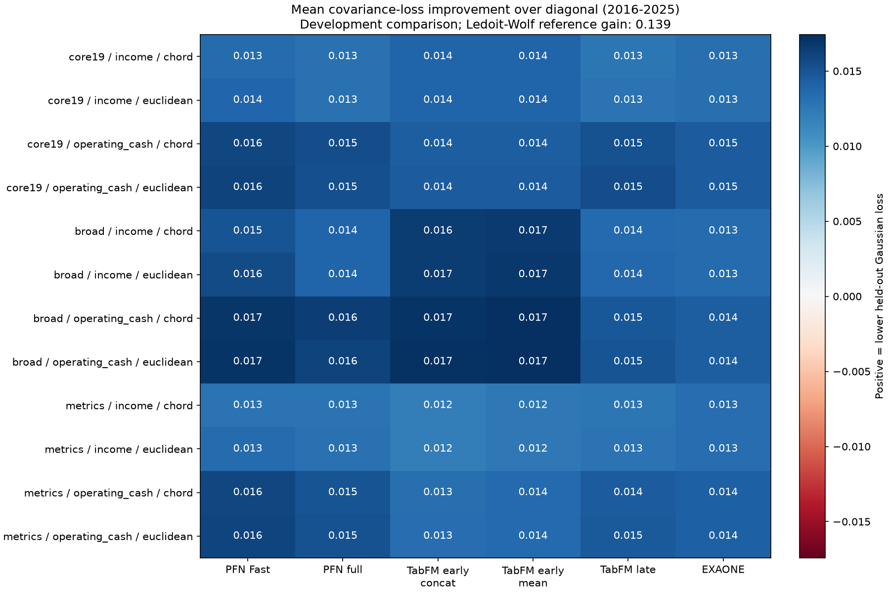

# Expanded experiment results

Development results from the fixed grid described in [README](README.md).
Foundation rows use income-label context, late readouts and chord distance;
matched input/compression controls use the same support preprocessing.
Positive gain means lower mean annual Gaussian covariance loss than the diagonal model.
Risk is annualized RMS of residual GMV returns, not tradable total-return volatility.
Both quantities are averaged across years; no best-variant selection is applied.

| Configuration | Loss gain | Residual risk | Years beating diagonal |
| --- | --- | --- | --- |
| `diagonal` | 0.00000 | 3.60% | 0 |
| `ledoit_wolf` | 0.13860 | 2.62% | 10 |
| `size` | 0.02662 | 4.38% | 10 |
| `accounting` | 0.01500 | 4.21% | 10 |
| `pca_5` | 0.01685 | 4.25% | 10 |
| `core19__standardized__euclidean` | 0.01321 | 4.25% | 10 |
| `core19__pca16__chord` | 0.01362 | 4.29% | 10 |
| `core19__autoencoder__chord` | 0.01471 | 4.33% | 10 |
| `core19__random_autoencoder__chord` | 0.00971 | 4.14% | 9 |
| `core19__income__tabpfn_fast__late__chord` | 0.01339 | 4.16% | 10 |
| `core19__income__tabpfn_full__late__chord` | 0.01296 | 4.13% | 10 |
| `core19__income__tabfm__late__chord` | 0.01264 | 4.12% | 10 |
| `core19__income__exaone__late__chord` | 0.01309 | 4.09% | 10 |
| `broad__standardized__euclidean` | 0.00836 | 4.02% | 9 |
| `broad__pca16__chord` | 0.01575 | 4.38% | 10 |
| `broad__autoencoder__chord` | 0.01604 | 4.37% | 10 |
| `broad__random_autoencoder__chord` | 0.00757 | 3.96% | 9 |
| `broad__income__tabpfn_fast__late__chord` | 0.01506 | 4.24% | 10 |
| `broad__income__tabpfn_full__late__chord` | 0.01397 | 4.18% | 10 |
| `broad__income__tabfm__late__chord` | 0.01358 | 4.13% | 10 |
| `broad__income__exaone__late__chord` | 0.01347 | 4.09% | 10 |
| `metrics__standardized__euclidean` | 0.00727 | 4.02% | 9 |
| `metrics__pca16__chord` | 0.01212 | 4.24% | 10 |
| `metrics__autoencoder__chord` | 0.01253 | 4.24% | 10 |
| `metrics__random_autoencoder__chord` | 0.00750 | 3.95% | 9 |
| `metrics__income__tabpfn_fast__late__chord` | 0.01290 | 4.15% | 10 |
| `metrics__income__tabpfn_full__late__chord` | 0.01289 | 4.11% | 10 |
| `metrics__income__tabfm__late__chord` | 0.01254 | 4.10% | 10 |
| `metrics__income__exaone__late__chord` | 0.01330 | 4.09% | 10 |

0 of 108 foundation-model configurations have lower mean
covariance loss than Ledoit-Wolf. This is a descriptive comparison across the
entire development grid, not a significance test or evidence of a causal effect.

## Geometry sensitivity

Spearman correlations compare the upper triangles of the same labeled cohort.
Ranges describe configurations and years; firm pairs are not independent samples.

| Change | Minimum | Median | Maximum |
| --- | --- | --- | --- |
| context | 0.396 | 0.760 | 1.000 |
| metric | 0.346 | 1.000 | 1.000 |

See `summary.csv` for every configuration and `permutation-comparisons.csv` for
unrestricted, industry-group and size-group shuffles of late-readout chord networks.
The SIC control uses current classifications. No multiple-comparison-adjusted
significance or causal interpretation is claimed. A new holdout is needed before
using this grid to choose an economic measurement model.
