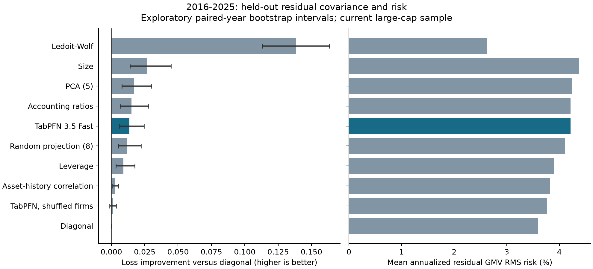

# Pilot results: 2016-2025

The pilot ran successfully with Yahoo prices, SEC disclosures, daily French
FF5+momentum factors, and actual TabPFN 3.5 Fast embeddings. The pretrained network
beats its shuffled counterpart and the diagonal covariance baseline, but does
not improve on conventional accounting proximity. Ledoit-Wolf performs best on
both covariance loss and residual portfolio risk.

## Sample and data checks

The current Yahoo screen produces **100 distinct eligible issuers**, reaching
screen rank 144 after 44 exclusions. Eligibility requires USD US-GAAP assets in
annual 10-K filings. This is a current large-cap sample with reporting-coverage
restrictions, not exactly the unrestricted top 100. Predecessor CIKs are not
linked, so some reorganized issuers are excluded or have shorter histories.

The ten annual cohorts contain **80, 84, 85, 87, 88, 89, 91, 92, 94, and 95 firms**.
Every model uses the same cohort within a year. There are 2,514 test dates,
1,173 accounting states, 19 features, and 18,517 selected facts. The audit finds
**zero future filing dates and zero future accounting-period ends** relative to
the specified cutoffs. This does not establish perfect economic comparability
or eliminate the acknowledged sample-selection and current-data-vintage biases.

Missingness is material: liabilities 30.4%, capex 31.5%, and R&D 44.2%. The current
small tag dictionary is a limitation; missing facts are imputed rather than
interpreted as zero. See [data quality](data-quality.json) and
[the full design](README.md) for selection, timing, and preprocessing details.

## Held-out results

Higher loss improvement is better. Gaussian loss is normalized per firm and omits
the common Gaussian constant; differences are not percentage return gains.
The risk measure is an average of annualized yearly **factor-residual** GMV
root-mean-square returns. It includes nonzero residual means and is not a demeaned
sample standard deviation or full-return investment performance.

| Model | Loss improvement over diagonal | Mean annualized residual GMV RMS risk |
| --- | ---: | ---: |
| Ledoit-Wolf | 0.13860 | 2.62% |
| Size | 0.02662 | 4.38% |
| PCA (5) | 0.01685 | 4.25% |
| Accounting ratios | 0.01500 | 4.21% |
| TabPFN 3.5 Fast | 0.01362 | 4.21% |
| Random projection (8) | 0.01205 | 4.11% |
| Leverage | 0.00904 | 3.90% |
| Fernandez-inspired asset history | 0.00298 | 3.82% |
| TabPFN with shuffled firm labels | 0.00125 | 3.76% |
| Diagonal | -0.00000 | 3.60% |

## Does pretraining add anything?

The paired annual comparisons use 5,000 year-bootstrap draws, seed 42:

- Against shuffled TabPFN links, the mean loss improvement is **0.01237**,
  with exploratory 95% interval **[0.00482, 0.02478]**; TabPFN wins in all ten years.
- Against accounting ratios, the improvement is **-0.00138**,
  interval **[-0.00380, 0.00052]**; TabPFN wins in only three years.
- Against PCA, the improvement is **-0.00323**,
  interval **[-0.00614, -0.00095]**; TabPFN wins in two years.
- Size beats TabPFN on covariance loss in every year. Ledoit-Wolf also wins in
  every year, with a mean loss advantage of **0.12498** over TabPFN.

TabPFN's residual GMV RMS risk is **4.21%**, compared with **3.60%** for diagonal
and **2.62%** for Ledoit-Wolf. Improved likelihood versus a diagonal model does not
translate into improved portfolio risk in this specification.

The fitted spatial intensities do not hit the imposed [-0.8, 0.8] bounds.
Moran I is descriptive only: with centered cross-sections, its permutation-null
expectation is -1/(N-1), not zero. We do not claim significance from its sign.

These intervals are exploratory: there are only ten years, estimation windows
overlap, annual outcomes can be dependent, and multiple models are compared.
There is no causal transmission or asset-pricing-premium claim.

## Implication for the paper

This establishes a runnable measurement-to-network-to-risk pipeline and a useful
benchmark to beat. It does **not** establish a pretrained-representation advantage.
The next experiment should improve accounting coverage, add industry and
size-matched controls, and test context/pooling/metric sensitivity with choices
fixed before evaluation. The current run uses one profitability-conditioned Fast
checkpoint and only 19 accounting features; it does not test the proposed broad
XBRL foundation-model measurement system.

The 2026 checkpoint is applied retrospectively to historical data. No claim is
made that investors could have used it during 2016-2025. One shuffled realization
and a random projection are limited controls, not substitutes for an identical
random transformer or a finance-trained autoencoder.

## Artifacts

- [Annual results](annual.csv), [aggregate results](summary.csv), and
  [paired comparisons](paired-comparisons.csv).
- [Selected universe](universe.csv), [exclusions](universe-exclusions.json), and
  [annual cohorts](cohorts.json).
- [Checkpoint revision](checkpoint.json), [input hashes](manifest.json), and
  [execution status](execution-status.json).
- [Exportable SVG figure](comparison.svg).

Reproduce with `just python-pilot` after configuring `EDGAR_IDENTITY` as described
in the [pilot README](README.md). Downloaded data and embeddings remain in ignored
`cache/`; the SEC request identity is not saved in these artifacts.
